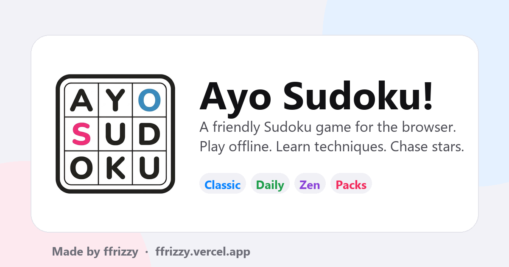

# Ayo Sudoku!

**A friendly, polished Sudoku game for the browser.** Play Classic, Daily, Zen, Challenge and handcrafted packs, online or offline. Learn techniques, chase stars, and keep your progress on your own device.

Made by **[ffrizzy](https://ffrizzy.vercel.app/)** · [Play Ayo Sudoku!](https://ayosudoku.vercel.app/) · [Source on GitHub](https://github.com/ffrizzyy/ayo-sudoku) · [Report a bug](https://github.com/ffrizzyy/ayo-sudoku/issues)

[](https://github.com/ffrizzyy/ayo-sudoku/actions/workflows/ci.yml)
[](LICENSE)



> *Ayo* means "let's go" in Indonesian. The exclamation mark is part of the name.

## What it is

Ayo Sudoku! is a local-first Sudoku app that feels at home on a phone. There are no accounts, no ads, no trackers and no leaderboard server. Every save, result and setting stays in `localStorage`, and the whole game shell is installable and playable without a connection.

### Modes

| Mode | What it is |
| --- | --- |
| **Classic** | Endless puzzles across six difficulty tiers and three board sizes (4x4, 6x6, 9x9). |
| **Daily** | One deterministic puzzle per UTC day, with its own streak and a playable archive of past days. |
| **Zen** | No timer pressure, no mistake limit, and generous hints. |
| **Challenge** | Fewer lives, no reveals, higher stakes. |
| **Packs** | 24 handcrafted puzzles in three star-gated packs, credited to ffrizzy. |
| **Learn** | Ten short lessons from scanning to advanced chains, each with practice. |
| **Import** | Paste a share code or an 81-character grid to play someone else's puzzle. |

### Details that matter

- **Pencil marks and colors.** Corner marks, center marks, and a color-marking palette.
- **Logic hints.** Nudges, pointers and reveals explain the next technique instead of just filling a cell.
- **Undo and redo.** Every board change is a command, so history is exact.
- **Stars, stats and streaks.** Per-tier records, mistake rates, daily calendar and achievements.
- **Accessibility.** Keyboard-first board, large text, high contrast, color-vision-friendly digits, left-handed layout, reduced motion and optional sound/haptics.
- **Bilingual.** Full English and Indonesian UI, including generated puzzle notes and lessons.
- **PWA.** Installable from the Home header or Settings at any time, offline-ready, with an update banner and a kill switch for bad releases.
- **Privacy.** No network requests at runtime. Your data never leaves the browser unless you export a backup.

## Run it

Requirements: **Node.js 22.12+** and **pnpm 12+**.

```bash
pnpm install
pnpm dev
```

Open <http://localhost:5173>.

### Scripts

| Command | Purpose |
| --- | --- |
| `pnpm dev` | Start the Vite dev server. |
| `pnpm build` | Typecheck and build the production bundle into `dist/`. |
| `pnpm preview` | Serve the production build locally. |
| `pnpm check` | Typecheck, run unit tests and verify EN/ID key parity. |
| `pnpm test` | Run the engine unit tests. |
| `pnpm test:watch` | Run tests in watch mode. |
| `pnpm i18n:check` | Check that every translation key exists in both languages. |
| `pnpm gen:pack` | Regenerate the pack puzzle data from the engine. |
| `pnpm typecheck` | TypeScript only. |

Benchmarks live in `scripts/bench.ts` and can be run with `pnpm tsx scripts/bench.ts`.

## Stack

| Layer | Choice |
| --- | --- |
| UI | React 19.3 + TypeScript 5.9 (strict) |
| Build | Vite 7.3 |
| Styling | Handwritten CSS with custom properties, no utility framework |
| Routing | Small hash router in `src/App.tsx` |
| i18n | Typed custom dictionary in `src/i18n` |
| Persistence | `localStorage` with versioned keys and JSON backup/restore |
| Puzzle generation | Pure TypeScript engine in a Web Worker |
| Tests | Vitest |

The reasons behind each choice, including the deliberate deviations from the original spec, are recorded in [docs/adr/0001-stack.md](docs/adr/0001-stack.md) and [docs/adr/0002-local-first-data.md](docs/adr/0002-local-first-data.md).

## Project layout

```text
src/
  app/        session storage, settings, stats, achievements, audio, packs, lessons
  config/     credits (the only place the author string lives)
  data/       generated pack puzzles
  engine/     pure puzzle engine: geometry, solver, generator, grader, hints, share codes
  i18n/       English and Indonesian dictionaries plus the provider
  screens/    Home, Game, Daily, Packs, Learn, Stats, Settings, About, Import, Onboarding
  styles/     tokens, base, components, screens
  ui/         board, number pad, sheets, icons, confetti, primitives
  App.tsx     hash routing, game launch/resume, PWA banners
  main.tsx    providers, error boundary, console credit
public/       manifest, icons, service worker, theme bootstrap, headers
docs/         architecture, ADRs, pack format
tests/        engine tests
```

See [docs/architecture.md](docs/architecture.md) for the data flow and layer rules.

## How puzzles work

- **Seeded generation.** A puzzle is a pure function of its seed. The generator fills a complete grid with a seeded PRNG, carves clues symmetrically, checks uniqueness with a bitmask solver, then grades the result with human-style techniques.
- **Daily determinism.** The seed is `ayo-daily-YYYY-MM-DD` in UTC, so every device gets the same puzzle. The tier follows the weekday: cozy, easy, medium, medium, hard, expert, medium.
- **Daily archive.** Because a daily is reproducible from its date, the Daily screen can offer a calendar of past days. Saves live under `daily:YYYY-MM-DD`, so an unfinished day can be resumed later; solved days keep their record and can be replayed. The archive starts at `DAILY_EPOCH` (2026-10-26), the first release, and does not invent earlier dates.
- **Stars.** One star for finishing. Two stars when you make at most two mistakes and use no reveal hints. Three stars when you also finish under the tier's par time.
- **Share codes.** `src/engine/share.ts` encodes the size, variant, givens and solution with a CRC check, producing a compact `AYO1-…` code. The importer also accepts 16, 36 or 81 character grids.
- **Packs.** `src/data/packs.json` is generated and graded by the engine, then shipped as static data. See [docs/puzzle-pack-format.md](docs/puzzle-pack-format.md).

## Data and privacy

Everything is stored under `ayo.*` keys in `localStorage`:

| Key | Contents |
| --- | --- |
| `ayo.settings.v1` | Theme, accent, input and accessibility preferences |
| `ayo.saves.v1` | One resumable save per mode; dailies are kept per date under `daily:YYYY-MM-DD` |
| `ayo.results.v1` | Finished games (capped history) |
| `ayo.daily.v1` | Daily results and streak |
| `ayo.packs.v1` | Pack progress and stars |
| `ayo.achievements.v1` | Unlocked achievements |
| `ayo.meta.v1` | Install id, lessons learned, modes and languages used |
| `ayo.theme` | Last resolved theme, read before first paint |
| `ayo.install.dismissed` | Install banner preference |

Settings → Data can export a JSON backup, import one, or clear everything. Clearing data is immediate and local. There is no telemetry endpoint to call.

## Deploy

The app is a static build, live at **<https://ayosudoku.vercel.app/>**.

The Vercel project is `ayosudoku`, connected to this repository, so every push to `main` deploys to production. Keep the defaults: `pnpm build`, output `dist`. `vercel.json` supplies the security headers, and `public/_headers` provides the same policy for Netlify or Cloudflare Pages.

```bash
pnpm build
pnpm preview
```

`index.html` carries the live canonical URL, `og:url` and absolute share images; `public/sitemap.xml` and `public/robots.txt` point at the same origin. If the game ever moves to a new domain, update those files together. `https://ffrizzy.vercel.app/` is the author's personal website, not the game.

To deploy by hand, run `vercel deploy --prod`. To test the production build locally, use `pnpm build && pnpm preview`.

If a service worker release ever needs to be retired, add `/sw-kill.json` at the site root with `{"kill": true}` (served as JSON). On the next visit the worker deletes its caches and unregisters itself. The worker ignores this file unless it returns JSON with `kill: true`, so a single page app that answers unknown paths with `index.html` cannot trigger it by accident.

## Accessibility

- The board is a labelled grid with roving focus and full keyboard controls (`1`–`9`, arrows, `Backspace`, `N` for notes, `H` for hint).
- Focus is visible, controls are real buttons, sheets trap focus and restore it on close, and live regions announce results.
- `prefers-reduced-motion`, `prefers-contrast` and `prefers-color-scheme` are respected, with explicit overrides in Settings.
- Color is never the only signal: conflicts use borders and text as well as color.

## Credits

**Ayo Sudoku! is designed, built and authored by [ffrizzy](https://ffrizzy.vercel.app/).** The name, puzzles, code and visual design are by ffrizzy.

Inspiration, with no affiliation or endorsement implied:

- [Cracking the Cryptic](https://www.crackingthecryptic.com/) — handcrafted puzzles, star progression and solver-friendly tools.
- [Apple Human Interface Guidelines](https://developer.apple.com/design/human-interface-guidelines/) — clarity, materials and rounded shapes.
- [Emil Kowalski](https://animations.dev/) — fast, purposeful, interruptible motion.

Open source thanks to React, Vite, TypeScript and Vitest. See the About screen for the in-app credits.

## License

[MIT](LICENSE) © 2026 ffrizzy.
