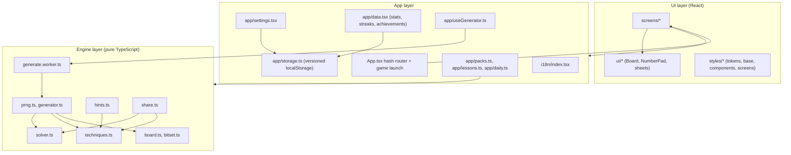

# Architecture

Ayo Sudoku! is a static single-page app. There is no server, no database and no network request at runtime. The architecture optimises for four things: a deterministic puzzle engine, a responsive game surface, safe local persistence, and an installable offline shell.

## Layers

The dependency rule points downward: UI may import the app layer and the engine, the app layer may import the engine, and the engine imports nothing outside itself. That keeps generation, grading and share codes testable in Node without a DOM.

## Routes

The router is a small `hashchange` hook in `src/App.tsx`. Hash routing keeps the static build portable (no rewrite rules) and makes deep links shareable.

| Route | Screen |
| --- | --- |
| `#/` | Home: mode, tier, size, continue card |
| `#/daily` | Daily puzzle, streak and calendar |
| `#/packs`, `#/pack/:id` | Pack list and detail |
| `#/learn`, `#/lesson/:id` | Lesson list and lesson |
| `#/stats` | Stats, records and achievements |
| `#/settings` | Preferences and data tools |
| `#/about` | About, credits and licenses |
| `#/import`, `#/import/:code` | Share-code and grid import |
| `#/game` | Active game (all modes) |

The App owns the active `SavedGame`; the Game screen receives it as `initial` and calls back for quit and next-puzzle actions. A generated game is written to its slot as soon as it is created, so a refresh resumes it.

## Game state

`SavedGame` (see `src/app/storage.ts`) contains:

- the `PuzzleDef` (givens, solution, tier, techniques, source);
- the current `CellSnapshot[]` (value, given, corner mask, center mask, color);
- a `history: Command[]` plus a `cursor`, where each command holds reversible `CellChange[]`;
- timer, mistakes, hint counts, lives, status and timestamps.

Board mutations produce one command. Undo moves the cursor back and applies the `before` snapshots; redo reapplies the `after` snapshots. New input after an undo truncates the redo tail. This makes every tool (values, marks, colors, auto-candidates, hints) undoable through one path.

`Game.tsx` autosaves on a short debounce and on `visibilitychange`/`pagehide`, so closing a tab on a phone does not lose progress.

## Persistence

All data lives in `localStorage` under versioned `ayo.*` keys. `storage.ts` owns reading, writing, backup and restore. Stats, daily history and pack progress are derived when a game finishes, then stored separately. `DataProvider` exposes the derived view to screens.

If `localStorage` is full or blocked, writes fail silently and the in-memory session continues; the UI stays usable. The Settings → Data export produces a single JSON backup with a schema version, so a future migration can accept old backups.

## Engine

- **Geometry** (`board.ts`): units, peers and box geometry for 4x4, 6x6 and 9x9, with optional diagonal units.
- **Candidates** (`bitset.ts`): digit sets as bitmasks; helpers count, iterate and format them.
- **Solver** (`solver.ts`): propagation (naked/hidden singles) followed by backtracking; `countSolutions` stops at two solutions to prove uniqueness.
- **Techniques and grading** (`techniques.ts`): human-style detectors, each returning placements/eliminations and an explanation key. `gradePuzzle` scores the hardest required technique and produces a tier.
- **Generation** (`generator.ts`): seeded PRNG → complete grid → symmetric carving → uniqueness check → grading. A puzzle is reproducible from its seed alone.
- **Hints** (`hints.ts`): plans a nudge, pointer or reveal from the current board and returns an explanation, not just a digit.
- **Share** (`share.ts`): packs size, variant, givens and solution with a CRC into `AYO1-…`; also parses plain 16/36/81 character grids. It re-solves imported puzzles and rejects invalid or ambiguous input.
- **Worker** (`generate.worker.ts`): runs generation off the main thread. `useGenerator` owns the worker, request ids, cancellation and a main-thread fallback for environments without workers.

The engine is covered by `tests/engine.test.ts`. Generation performance is measured by `scripts/bench.ts`.

## Daily puzzles

`app/daily.ts` derives the date key in UTC and builds the seed `ayo-daily-YYYY-MM-DD`. The weekday picks the tier: cozy, easy, medium, medium, hard, expert, medium. Because generation is deterministic and versioned by puzzle id, every device gets the same board. A `DailyRecord` stores the result; the streak walks backwards from today with one rest day allowed.

## Internationalisation

`src/i18n/index.tsx` holds two typed dictionaries and a provider. `t(key, vars)` does dot lookup, `{name}` interpolation and falls back to the key for development. The provider sets `<html lang>` and persists changes through settings. `scripts/check-i18n.ts` compares the key trees in both languages and fails CI on mismatch. Content that is data rather than UI (pack titles, lesson steps) stores `{ en, id }` objects and resolves through a helper.

## PWA and offline

- `public/manifest.webmanifest` defines the install experience, icons and shortcuts.
- `public/theme.js` runs before first paint and applies the stored theme; it is external so the CSP can forbid inline scripts.
- `public/sw.js` precaches the shell, serves navigations network-first with an offline fallback, and uses stale-while-revalidate for hashed assets.
- The App registers the worker in production only. When a new worker is waiting, an update banner offers a reload; `SKIP_WAITING` triggers `controllerchange`.
- `/sw-kill.json` is an emergency switch: if present, the worker deletes caches and unregisters.

## Security

- Strict CSP and companion headers in `vercel.json` and `public/_headers`.
- No `dangerouslySetInnerHTML`; imported text is rendered as React text.
- Share codes are length-limited and CRC-checked, and imported grids are solved before play.
- No third-party scripts, fonts or analytics. Icons and the theme bootstrap are served from the same origin.

## Accessibility

The board exposes a single roving tab stop with arrow-key navigation. Digits, notes and hints have keyboard shortcuts. Sheets manage focus and escape. Status changes go through polite live regions. Visual preferences are data attributes on `<html>` (`data-theme`, `data-accent`, `data-large-text`, `data-contrast`, `data-cvd`, `data-handed`, `data-reduced-motion`), so CSS can respond without JavaScript per component.

## Deliberate deviations

The original spec proposed Tailwind, Biome, Playwright, Storybook, IndexedDB, Comlink and a folder-per-store structure. This build ships a smaller, dependency-light version that keeps the product behavior and drops tooling that would not pay for itself in v1. The reasoning and trade-offs are recorded in:

- [ADR 0001: Stack](adr/0001-stack.md)
- [ADR 0002: Local-first data](adr/0002-local-first-data.md)
- [ADR 0003: Generated packs](adr/0003-generated-packs.md)
